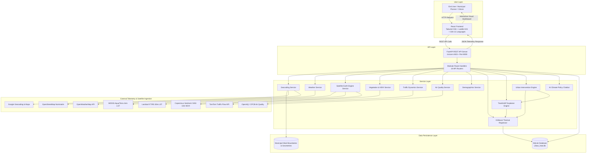
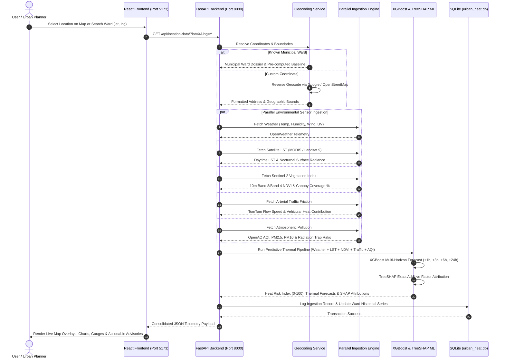
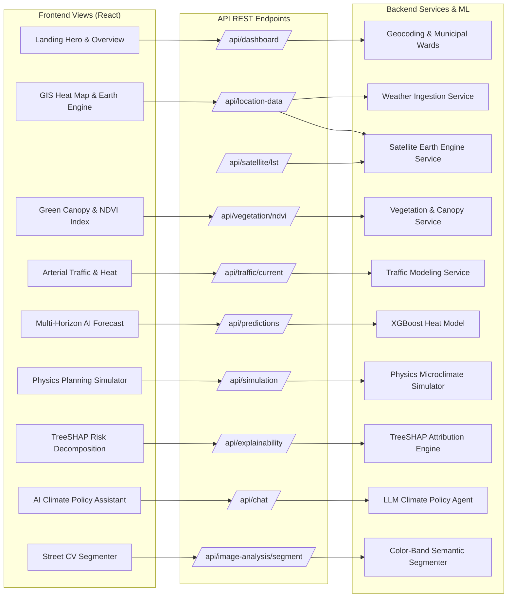
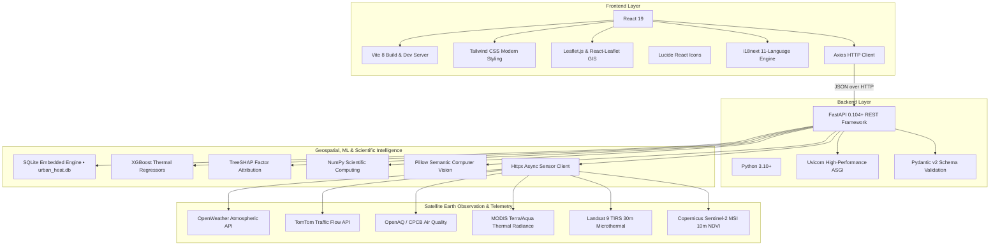

# Urban Heat Entrapment Prediction and Prevention Model (UrbanHeat AI)

> **"Predict. Understand. Prevent Urban Heat."**

An AI-powered urban climate intelligence and decision support platform that monitors microclimate heat entrapment using multi-satellite Earth observation (MODIS LST, Landsat 9 TIRS, Copernicus Sentinel-2 MSI), live IoT sensor fusion (OpenWeather, OpenAQ/CPCB, TomTom Traffic Flow), machine learning (multi-horizon XGBoost thermal regressors), Explainable AI (TreeSHAP additive attribution), and physics-informed urban planning simulation.

---

## 🌟 Key Pillars & Features

1. **GIS Interactive Command Center**:
   - Leaflet.js map with multiple thematic layers (Google Earth Engine roadmap, Satellite LST thermal overlay, NDVI canopy vegetation, arterial traffic friction, population vulnerability, civic cooling shelters).
   - Dynamic slide-over ward dossier with real-time thermodynamic metrics.

2. **Multi-Source Sensor & Earth Observation Fusion**:
   - **OpenWeather / CAAQMS**: 2m atmospheric temperature, relative humidity, wind speed, barometric pressure, solar UV index.
   - **Satellite LST (MODIS / Landsat 9)**: Daytime surface skin radiance vs nocturnal thermal entrapment.
   - **Sentinel-2 MSI (Copernicus)**: $10\text{m}$ resolution NDVI vegetation index & municipal canopy deficit calculation.
   - **TomTom Traffic Flow API**: Arterial speed, congestion ratio, and thermodynamic combustion heat modeling.
   - **OpenAQ / CPCB**: Air quality index (AQI), PM2.5, PM10, $\text{NO}_2$, $\text{SO}_2$, $\text{O}_3$, and longwave radiation trapping.
   - **WorldPop & OpenStreetMap**: $100\text{m}$ population density disaggregation, sensitive infrastructure mapping (schools, hospitals), and dynamic urban activity modeling.

3. **Predictive Machine Learning Engine**:
   - Multi-horizon XGBoost thermal regressors with 95% confidence intervals (+1h, +3h, +6h, +24h, Tomorrow Peak).
   - Calibrated 0–100 **Heat Risk Index** and IPCC AR6 **Heat Vulnerability Index (HVI)**.

4. **Explainable AI (TreeSHAP)**:
   - Decomposes local risk scores into exact additive Shapley contributions for each thermodynamic factor.
   - Natural language physical explanations for municipal planners and citizens.

5. **Interactive Urban Planning Simulator**:
   - Dual-view microclimate scenario simulator with real-time responsive sliders:
     * Tree canopy expansion ($0$ to $+50\%$)
     * High-albedo cool roofs ($0$ to $100\%$)
     * Arterial traffic reduction ($0$ to $-50\%$)
     * Green roof infrastructure ($0$ to $+50\%$)
     * Pedestrian solar shading ($0$ to $+50\%$)
     * Urban wetlands & water misting ($0$ to $+30\%$)
   - Calculates projected cooling relief ($\Delta^\circ\text{C}$), risk score mitigation ($\Delta\%$), and annual carbon avoidance ($\text{tCO}_2/\text{year}$).

6. **Computer Vision Street & Drone Image Analyzer**:
   - Semantic segmentation of street photos into vegetative canopy, built-up concrete, asphalt roadway, and shadows.
   - Computes material-grounded **Visual Heat Exposure Scores** ($0\text{--}100$).

7. **Carbon Reduction & Sequestration Calculator**:
   - Models IPCC/EPA urban greenhouse gas emission avoidance and vegetative carbon sequestration.

8. **AI Climate Decision Support Assistant**:
   - Context-grounded municipal climate chatbot providing policy formulation, ward comparisons, and intervention advice.

9. **Multi-Lingual Localization (11 Indian & International Languages)**:
   - Full native translation catalogs: English, Hindi (हिन्दी), Marathi (मराठी), Gujarati (ગુજરાતી), Bengali (বাংলা), Tamil (தமிழ்), Telugu (తెలుగు), Kannada (ಕನ್ನಡ), Malayalam (മലയാളം), Punjabi (ਪੰਜਾਬੀ), Urdu (اردو).

10. **Scientific Data Transparency & Fallback Engine**:
    - Transparent `DataSourceBadge` indicators distinguishing between **Live API Observations**, **Periodic Satellite Overpasses**, and **Calibrated Demo Datasets**.

---

## 🏗️ System Architecture

### 1. High-Level System Architecture Diagram



---

### 2. End-to-End Data Flow Sequence Diagram



---

### 3. Component & Service Architecture Mapping



---

### 4. Entity-Relationship (ER) Database Architecture

```mermaid
erDiagram
    LOCATIONS ||--o{ WEATHER_DATA : "records"
    LOCATIONS ||--o{ SATELLITE_DATA : "measures"
    LOCATIONS ||--o{ VEGETATION_DATA : "monitors"
    LOCATIONS ||--o{ TRAFFIC_DATA : "tracks"
    LOCATIONS ||--o{ AIR_QUALITY_DATA : "samples"
    LOCATIONS ||--o{ POPULATION_DATA : "houses"
    LOCATIONS ||--o{ PREDICTIONS : "generates"

    LOCATIONS {
        string id PK "Unique location slug (e.g., nerul)"
        string name "Ward / Sector name"
        string city "City name"
        string state "State name"
        string country "Country ISO"
        float latitude "Geographic latitude"
        float longitude "Geographic longitude"
        float area_sq_km "Ward area"
        integer baseline_population "Demographic baseline"
        float baseline_ndvi "Baseline vegetation index"
        float baseline_lst "Baseline surface temperature"
        float baseline_temp "Baseline air temperature"
        integer baseline_aqi "Baseline air quality index"
        float baseline_traffic_congestion "Baseline congestion ratio"
        json boundary_geojson "Ward polygon boundary"
    }

    WEATHER_DATA {
        integer id PK "Primary key"
        string location_id FK "References LOCATIONS(id)"
        float temperature "2m atmospheric temp (°C)"
        float humidity "Relative humidity (%)"
        float wind_speed "Wind velocity (km/h)"
        float pressure "Atmospheric pressure (hPa)"
        float uv_index "Solar ultraviolet index"
        string condition "Weather condition"
        float feels_like "Apparent thermal sensation (°C)"
        datetime timestamp "Observation timestamp"
        string source "Data origin (live/cached/demo)"
        string status "Pipeline ingestion status"
    }

    SATELLITE_DATA {
        integer id PK "Primary key"
        string location_id FK "References LOCATIONS(id)"
        float lst_day "Daytime Land Surface Temp (°C)"
        float lst_night "Nocturnal Land Surface Temp (°C)"
        string thermal_intensity "Entrapment severity classification"
        datetime timestamp "Satellite overpass timestamp"
        string source "Satellite instrument (MODIS/Landsat/Sentinel)"
        string status "Data quality status"
    }

    VEGETATION_DATA {
        integer id PK "Primary key"
        string location_id FK "References LOCATIONS(id)"
        float ndvi "Normalized Difference Vegetation Index"
        float green_cover_pct "Canopy coverage percentage"
        float gap_pct "Deficit below municipal target"
        datetime timestamp "Observation timestamp"
        string source "Copernicus Sentinel-2 MSI"
        string status "Data quality status"
    }

    TRAFFIC_DATA {
        integer id PK "Primary key"
        string location_id FK "References LOCATIONS(id)"
        float congestion_index "Speed reduction ratio"
        float congestion_pct "Congestion percentage"
        float traffic_heat_contribution "Modeled anthropogenic heat (°C)"
        datetime timestamp "Telemetry timestamp"
        string source "TomTom Traffic Flow API"
        string status "Data quality status"
    }

    AIR_QUALITY_DATA {
        integer id PK "Primary key"
        string location_id FK "References LOCATIONS(id)"
        integer aqi "Air Quality Index"
        float pm25 "PM2.5 concentration (µg/m³)"
        float pm10 "PM10 concentration (µg/m³)"
        string category "Air quality band"
        datetime timestamp "Measurement timestamp"
        string source "OpenAQ / CPCB CAAQMS"
        string status "Data quality status"
    }

    POPULATION_DATA {
        integer id PK "Primary key"
        string location_id FK "References LOCATIONS(id)"
        float population_density_per_sq_km "People per km²"
        integer baseline_population "Total population"
        float area_sq_km "Ward area"
        datetime timestamp "Census/WorldPop timestamp"
    }

    PREDICTIONS {
        integer id PK "Primary key"
        string location_id FK "References LOCATIONS(id)"
        float predicted_temp_1h "+1 Hour forecast (°C)"
        float predicted_temp_3h "+3 Hour forecast (°C)"
        float predicted_temp_6h "+6 Hour forecast (°C)"
        float predicted_temp_24h "+24 Hour forecast (°C)"
        float confidence_lower "95% CI lower bound"
        float confidence_upper "95% CI upper bound"
        float heat_risk_score "Calibrated Risk Index (0-100)"
        string heat_risk_category "MODERATE / HIGH / EXTREME"
        datetime created_at "Inference timestamp"
    }
```



---

### 5. Technology Stack Architecture



---

### 6. Clean Workspace Structure

```
UHE_mini/
├── backend/
│   ├── .env                 # API keys & configuration
│   ├── .env.example         # Environment template
│   ├── app/
│   │   ├── api/             # 18 Modular REST Route Handlers
│   │   │   ├── api_status.py
│   │   │   ├── auth.py
│   │   │   ├── carbon.py
│   │   │   ├── chatbot.py
│   │   │   ├── dashboard.py
│   │   │   ├── explainability.py
│   │   │   ├── heatwave.py
│   │   │   ├── image_analysis.py
│   │   │   ├── location_data.py
│   │   │   ├── locations.py
│   │   │   ├── pollution.py
│   │   │   ├── population.py
│   │   │   ├── predictions.py
│   │   │   ├── recommendations.py
│   │   │   ├── satellite.py
│   │   │   ├── search.py
│   │   │   ├── simulation.py
│   │   │   ├── traffic.py
│   │   │   ├── vegetation.py
│   │   │   ├── vulnerability.py
│   │   │   └── weather.py
│   │   ├── config.py        # Settings & transparent fallback engine
│   │   ├── database.py      # SQLite geospatial persistence (15 entities)
│   │   ├── main.py          # FastAPI application entrypoint
│   │   ├── ml/              # Machine learning, SHAP, CV segmenter & simulator
│   │   │   ├── carbon_calculator.py
│   │   │   ├── explain_shap.py
│   │   │   ├── feature_engineering.py
│   │   │   ├── heat_model.py
│   │   │   ├── hotspot_clustering.py
│   │   │   ├── image_segmenter.py
│   │   │   └── simulator_engine.py
│   │   ├── schemas/         # Pydantic request/response schemas
│   │   │   └── schemas.py
│   │   ├── seed_data/       # Pre-seeded municipal ward datasets
│   │   │   └── seed_cities.py
│   │   └── services/        # External sensor & satellite ingestion services
│   │       ├── ai_assistant_service.py
│   │       ├── earth_engine_service.py
│   │       ├── geocoding_service.py
│   │       ├── pollution_service.py
│   │       ├── population_service.py
│   │       ├── satellite_service.py
│   │       ├── traffic_service.py
│   │       ├── vegetation_service.py
│   │       └── weather_service.py
│   └── tests/
│       └── test_all_features.py  # Comprehensive 21-test verification suite
├── frontend/
│   ├── dist/                # Production web application bundle
│   │   ├── assets/          # JavaScript, CSS & SVG graphics
│   │   └── index.html       # Production entry HTML
│   ├── public/              # Static assets served by Vite
│   │   └── assets/
│   ├── src/                 # React source code & translation catalogs
│   │   ├── assets/
│   │   ├── locales/         # 11 Indian & International language catalogs
│   │   ├── App.css
│   │   ├── App.jsx
│   │   ├── i18n.js
│   │   ├── index.css
│   │   └── main.jsx
│   ├── index.html           # Frontend entry HTML
│   ├── package.json         # Frontend dependencies & npm scripts
│   ├── package-lock.json
│   └── vite.config.js       # Vite configuration & /api reverse proxy
├── package.json             # Root workspace scripts
├── run_website.bat          # Windows one-click launcher
├── run_website.py           # Unified backend + frontend service manager
├── urban_heat.db            # SQLite database with pre-seeded municipal telemetry
└── README.md                # Comprehensive documentation & architecture
```

---

## 🚀 Quick Start (Running the Website)

**Prerequisites**: Python 3.10+, Node.js 18+

### Option A: One-Command Instant Launch (Recommended)
Start both backend & frontend together with **a single command**:

```bash
python run_website.py
```
*(On Windows, you can also simply double-click `run_website.bat` or run `npm start` / `npm run dev` from the root folder)*

This script will:
1. Verify and automatically self-heal all frontend bundles and static assets.
2. Launch the FastAPI backend server on port `8000`.
3. Launch the Vite frontend dev server on port `5173`.
4. Automatically open `http://localhost:5173/` in your default browser.

---

### Option B: Two-Terminal Launch

```bash
# Terminal 1: Backend
pip install fastapi uvicorn pydantic python-multipart pillow numpy httpx
python -m uvicorn backend.app.main:app --host 127.0.0.1 --port 8000 --reload

# Terminal 2: Frontend
cd frontend
npm install
npm run dev
```

---

### 🌐 Access Points & Verification
- **Application Dashboard (UI)**: [http://localhost:5173/](http://localhost:5173/)
- **FastAPI Documentation (Swagger UI)**: [http://127.0.0.1:8000/docs](http://127.0.0.1:8000/docs)
- **Live Telemetry Stream**: [http://127.0.0.1:8000/api/dashboard/?location_id=nerul](http://127.0.0.1:8000/api/dashboard/?location_id=nerul)
- **Run Diagnostic Tests**: `python -m backend.tests.test_all_features`

---

## 🛡️ Scientific Formulations

- **Normalized Difference Vegetation Index (NDVI)**:
  $$\text{NDVI} = \frac{\text{NIR}_{842\text{nm}} - \text{Red}_{665\text{nm}}}{\text{NIR}_{842\text{nm}} + \text{Red}_{665\text{nm}}}$$

- **Congestion Ratio**:
  $$\text{Congestion} = 1.0 - \frac{\text{Speed}_{\text{observed}}}{\text{Speed}_{\text{free-flow}}}$$

- **Estimated Vehicular Heat Contribution**:
  $$Q_{\text{traffic}} = (\text{Congestion} \times 16.0) + \max\left(0, \frac{50 - v}{50} \times 8.0\right) + \max(0, (T_{\text{amb}} - 30) \times 0.4)$$

- **Heat Vulnerability Index (HVI)**:
  $$\text{HVI} = (\text{Exposure} \times 0.45) + (\text{Sensitivity} \times 0.35) - (\text{AdaptiveCapacity} \times 0.20)$$

---

## 📜 Academic Attribution & License
Developed as a Major College Capstone Project in Urban Climate Intelligence, Geospatial Artificial Intelligence, and Sustainable City Planning.
